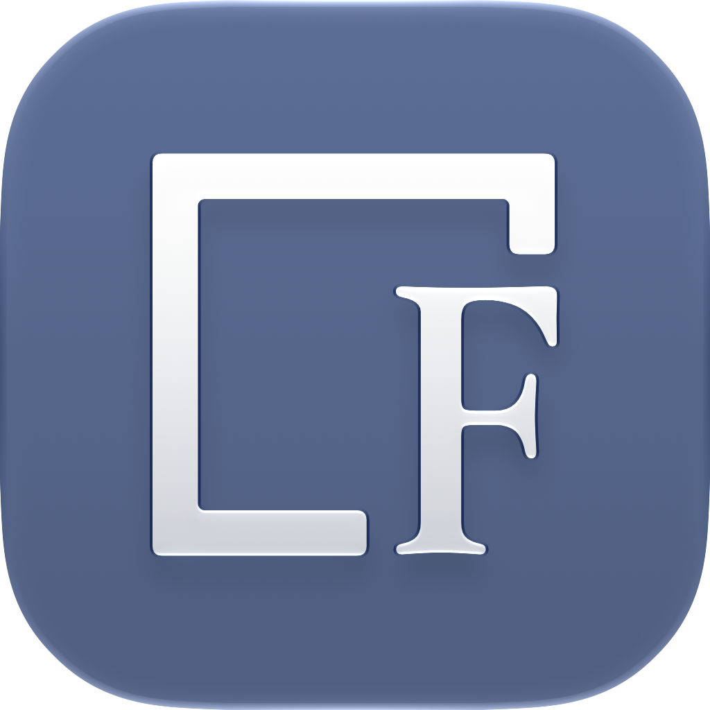

<p align="center">
  
</p>

<h1 align="center">FrameNote</h1>
<h2 align="center">Leave your mark.</h2>

<p align="center">
  Add a watermark, logo, or photo details.<br />
  Photos stay on your device — in your browser or the desktop app.
</p>

<p align="center">
  <a href="CHANGELOG.md"></a>
</p>

<p align="center">
  <a href="https://framenoteapp.netlify.app">Open web app</a> ·
  <a href="#quick-start">Quick start</a> ·
  <a href="docs/USER_GUIDE.md">User guide</a> ·
  <a href="docs/DEVELOPMENT.md">Development</a> ·
  <a href="CHANGELOG.md">Changelog</a>
</p>

---

FrameNote adds watermarks, logos and photo metadata to your images. Compose
layers with text and graphics, save reusable presets, and export JPGs or PNGs individually
or as a ZIP. Processing stays on your device; no account or backend is required.

**Beta:** web and Electron desktop share the same editor. Desktop packages target
macOS Apple Silicon, Windows x64 and Linux x64. See [installation and platform
limitations](docs/DESKTOP.md).

## Features

- EXIF/IPTC/XMP metadata tokens mixed with text, SVG/PNG graphics and icons.
- Independent layers, positioning, margins, color and Glass backgrounds.
- Bundled fonts plus installed system fonts in the desktop app.
- Local presets with shared v1 JSON import/export across web and desktop.
- JPG/PNG export, JPG quality and metadata controls, with batch export to ZIP.
- Desktop Settings with local configuration, undo limits and window restoration.

## Quick start

Use [FrameNote in your browser](https://framenoteapp.netlify.app), or run it locally
with the steps below.

Requires Node.js from [`.nvmrc`](.nvmrc) and pnpm from [`package.json`](package.json).
From the repository root:

```sh
pnpm i

pnpm dev      # Web — http://localhost:3000
pnpm desktop  # Desktop — live preview
```

Choose the app you want to run. For environment setup, builds and tests, see
[Development](docs/DEVELOPMENT.md). For local installation, see
[Desktop](docs/DESKTOP.md#local-macos-installation).

## Documentation

- [User guide: editing, presets, export and limits](docs/USER_GUIDE.md)
- [Desktop: installation, storage, packaging and GitHub Releases](docs/DESKTOP.md)
- [Development: commands, tests, workspace and versioning](docs/DEVELOPMENT.md)
- [Caption metadata tokens](docs/CAPTION_TAGS.md)
- [Preset format v1](docs/PRESET_FORMATS.md)
- [Fonts and licenses](docs/FONT_LIBRARY.md)
- [Design system](docs/DESIGN_SYSTEM.md)
- [Product context](docs/PRODUCT.md) · [Deferred ideas](docs/NICE_TO_HAVE.md)
- [Changelog](CHANGELOG.md)

Some internal planning documents are maintained in Polish.

## License

FrameNote's original software code is licensed under **GPL-3.0-or-later**.
Copyright © 2026 Rafał Karczmarzyk. See [LICENSE](LICENSE) and
[licensing and asset exceptions](LICENSING.md). The software comes without warranty.

Bundled sample photographs have separate, noncommercial terms; fonts and
dependencies retain their own licenses, and some artwork is excluded from the
software license. These terms do not apply to your own photos or exported images.
New releases include a source archive alongside the downloads; see
[building and redistributing FrameNote](docs/SOURCE_DISTRIBUTION.md).
